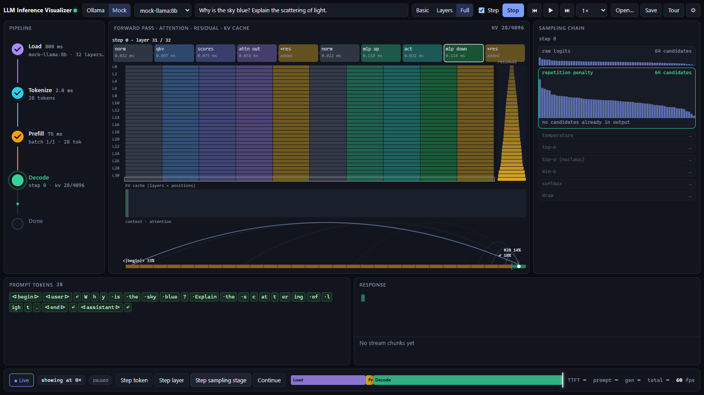

# LLM Inference Visualizer

An Electron app that animates every stage of LLM inference in real time. It follows a prompt through tokenization (with BPE merges), prefill, each decode step's layers, attention, residual stream, KV cache and sampling chain, and into the streamed response. Data comes from an instrumented Ollama build, a built-in mock, or a recorded trace.



## Quick start

Requirements: Node 24 and pnpm 9 (`npm i -g pnpm@9`).

```sh
pnpm install
pnpm dev            # opens the app; Source = Mock works with no other process
```

Press **Run**. Pick a detail level:

- **Basic**: phase pipeline, token chips, top-k sampling bars, response stream, timeline.
- **Layers**: adds the per-layer stack (timing / norm) and KV cache bar.
- **Full**: forward-pass sub-blocks, attention arcs, residual stream, KV slot grid, the full sampler funnel (raw → rep-penalty → temperature → top-k → top-p → min-p → softmax → draw), tokenizer merge animation and byte-level streaming. Full detail is a slow-motion mode. Tick **Step** and use *Step token / Step layer / Step sampling stage / Continue*.

Click any token, layer, op or sampling stage to open the **Inspector** with the raw events and derived numbers. Press `Ctrl+Shift+D` to toggle the engine debug panel. **Tour** runs a guided walkthrough.

### Running against mock processes (full real-world path)

```sh
pnpm mock-ollama-http                          # fake Ollama on :11434 (/api/chat, /api/tags, /api/show)
pnpm mock generate --layers 32 --response-tokens 200 --tok-per-sec 60 --detail full
pnpm mock replay traces/fixtures/short-answer.ndjson --speed 0.5 --loop
```

With **Source = Ollama**, the app calls `/api/chat` on `mock-ollama-http`. The mock emits a correlated trace to the app's socket, exactly like patched Ollama does. Traces from `mock generate` / `replay` that the app didn't start are followed automatically.

### Running against Ollama

- **Stock Ollama**: works in degraded mode. The token stream comes from the public API only, and the app shows *"running without instrumentation"*.
- **Patched Ollama**: provides the trace side-channel. See [`ollama-patch/build.md`](ollama-patch/build.md). In short, build the patched `ollama.exe` and start it with `OLLAMA_TRACE_URL=ws://127.0.0.1:4711/ingest`. Then select **Source = Ollama** in the app.

This Ollama version runs every GGUF model inside llama.cpp's `llama-server` subprocess. As a result, the Go-only patch provides the **basic** tier: prompt tokens, top-k logprobs, timings and step mode. Per-layer, attention, residual and sampler-chain events need a patched llama.cpp build. [`ollama-patch/NOTES.md`](ollama-patch/NOTES.md) documents the hook points. The app flags the missing tiers using the `capabilities` field in `request.received`.

## Architecture

```
┌────────────── Electron app ───────────────────────────────────────────────┐
│ main process                                                              │
│   TraceHub  ws://127.0.0.1:4711  /ingest ◄── producers (Ollama, mock)     │
│                                  /view   ──► renderer windows (verbatim)  │
│             acks: /view ──► /ingest            IPC: trace:status only     │
│ renderer                                                                  │
│   TraceClient ─► Player per request                                       │
│                    ├ seq-ordered ring buffer (drops droppable first)      │
│                    ├ PlaybackClock (min stage durations, catch-up,        │
│                    │                auto-degrade, seek, step)             │
│                    └ InferenceStateMachine ─► immutable ViewModel         │
│   one requestAnimationFrame loop ─► Zustand store (≤1 update/frame)       │
│                                  └► PixiJS canvases (layers, fwd pass)    │
│   React + Motion: pipeline, chips, sampling, funnel, timeline, inspector  │
│   Run: POST /api/chat (stream) with X-Trace-Request-Id / -Detail / -Step  │
└───────────────────────────────────────────────────────────────────────────┘
```

| Concern | Decision |
|---|---|
| Transport | WebSocket carrying NDJSON. The app hosts the hub; producers connect when `OLLAMA_TRACE_URL` is set. |
| Token data | The app streams the public `/api/chat`. The trace socket only adds what the API can't see. |
| Correlation | The app generates a UUID per run and sends it as `X-Trace-Request-Id`. Producers echo it in every event. |
| Animation | A playback clock with per-stage minimum on-screen durations. It speeds up smoothly (up to 8×) when the display lags real time by more than 2 s, and returns to 1× below 250 ms. The current dilation factor is always shown. |
| Detail | `X-Trace-Detail: basic\|layers\|full`. Events above the selected level are filtered at ingestion. In Full detail, a backlog over 4 s drops to Layers and shows a "fast-forwarding" badge. |
| Step mode | `X-Trace-Step: token`. The runner blocks per step until it gets an `ack` on the socket. The app sends acks only when its buffer runs dry. |

## Repository layout

```
apps/visualizer         Electron app (electron-vite, React, Zustand, Motion, PixiJS)
packages/trace-schema   zod event schema, parseEvent, priorities, detail tiers (+ docs generator)
packages/tokenizer      byte-level BPE (GGUF vocab/merges) with merge tracing, trainer
packages/trace-mock     generator, replay CLI, mock-ollama-http, hub client
ollama-patch/           Go patch for Ollama + NOTES / build instructions
traces/                 NDJSON fixtures and recorded real traces (see traces/README.md)
docs/events.md          event reference (generated: pnpm --filter trace-schema docs)
```

## Scripts

| | |
|---|---|
| `pnpm dev` | run the app with hot reload |
| `pnpm test` | unit tests (schema, tokenizer, mock, engine) |
| `pnpm lint` | ESLint + Prettier check |
| `pnpm -r typecheck` | TypeScript |
| `pnpm build` | build the app |
| `pnpm --filter visualizer e2e` | Playwright e2e against the built Electron app |
| `pnpm --filter visualizer package` | installers via electron-builder (`release/`) |
| `pnpm gen-fixtures` | regenerate `traces/fixtures` |

## Settings

Open the ⚙ menu to change:

- trace port and Ollama URL
- stage and sub-step minimum durations
- maximum catch-up speed, catch-up threshold and auto-degrade threshold
- step granularity
- per-head attention (mock)
- reduced motion: follows the OS setting by default, or can be forced on or off
- prompt-chip collapse limit
- auto-save

Every run is saved as `.ndjson` plus a `.response.txt` under the app's `userData/sessions`. **Save** writes the current trace wherever you choose, and **Open…** replays a trace offline with the scrubber.

## Troubleshooting

| Symptom | Cause / fix |
|---|---|
| "Ollama is not reachable" | Start Ollama (`ollama serve`) or check the URL in ⚙. |
| "Model … not found" | `ollama pull <model>` |
| "Running without instrumentation" | Ollama is stock, or `OLLAMA_TRACE_URL` isn't set or points at the wrong port. The status dot in the title bar shows how many producers are connected. |
| "runner has no per-layer data" | Patched Ollama (Go-only) provides the basic tier. Per-layer detail needs the llama.cpp hooks (see NOTES.md). |
| "Trace tokens differ from /api/chat response" | Output parsers in Ollama (thinking or tool parsing) changed the visible text compared with the raw tokens. |
| Merge animation skipped | The model's tokenizer isn't byte-level BPE (e.g. SentencePiece), or the JS tokenizer disagrees with the runner's ids. |
| Port 4711 in use | Change it in ⚙ (the hub restarts), and use the same port in `OLLAMA_TRACE_URL`. |
